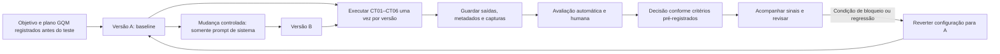

# Ciclo de vida e versionamento

Descrever a cadeia de mudança, execução, avaliação, decisão e acompanhamento do fluxo generativo, mantendo rastreabilidade entre casos, saídas e versões.

## Tarefa

Documentar o ciclo de vida experimental do objetivo à decisão e ao acompanhamento.

## Diagrama



## Cadeia de rastreabilidade

```text
caso (CT01–CT06) -> saída (versão-caso) -> nota (R1; R2 em CT01/CT05) -> decisão -> versão (A/B)
```

As versões experimentais A/B ainda dependem da definição e do registro dos prompts; as saídas, notas e decisões só podem ser vinculadas depois das respectivas etapas. Preservar os prompts, os manifestos e os resultados sem sobrescrever versões anteriores.

| Caso | Saída A/B | Identificador anônimo | Nota(s) | Decisão | Versão/manifesto |
|---|---|---|---|---|---|
| [PREENCHER] | [PREENCHER] | [PREENCHER] | [PREENCHER] | [PREENCHER] | [PREENCHER] |

## Reprodução e reversão

### É possível reconstruir uma saída pelo manifesto?

Ainda não integralmente. O manifesto registra o commit do Cherry Studio, a versão do modelo e as limitações conhecidas, mas os prompts, os parâmetros efetivamente usados, a data, os arquivos/contexto recuperados e os artefatos de execução precisam ser registrados antes/depois de cada execução. Mesmo com esses dados, o alias `latest` não congela a revisão do modelo e pode mudar; além disso, uma execução por caso/versão não mede a variabilidade entre execuções. Assim, a reconstrução da configuração pode ser documentada, mas a reprodução exata da saída não é garantida.

### Que sinal acompanhar e como voltar a A?

Acompanhar, por versão, a aprovação humana R1 (aprovadas/6), a contagem de falhas críticas e a concordância entre sinal automático e R1 (concordantes/12 no conjunto). Usar os limites de avanço e bloqueio registrados previamente no plano GQM; eles ainda precisam ser preenchidos antes do teste. Uma falha crítica ou o não atendimento ao critério pré-registrado deve bloquear a adoção, não justificar ajuste retroativo do critério.

Para voltar à configuração A, interromper o uso de B, restaurar literalmente o prompt de sistema arquivado em `atividade3/versoes/A/prompt.md` e conferir o manifesto A, mantendo constante o commit do software, o modelo selecionado, os parâmetros, as fontes e o contexto sempre que operacionalmente possível. Registrar a reversão, sua data, o motivo e uma verificação com casos definidos pela equipe; não substituir os registros anteriores de B.

## Análise do artefato

Com os campos pendentes dos manifestos preenchidos e os artefatos de execução preservados, a cadeia caso -> saída -> nota -> decisão -> versão pode ser auditada. No estado atual, essa rastreabilidade ainda não pode ser demonstrada porque os prompts experimentais e as evidências de execução não foram registrados.

## Resultados

Pendentes da execução e da avaliação. Não há saídas, notas ou decisões experimentais disponíveis neste repositório até o momento.
