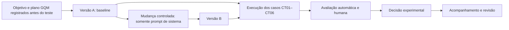

# Ciclo de vida e versionamento

Descrever a cadeia de mudança, execução, avaliação, decisão e acompanhamento do fluxo generativo, mantendo rastreabilidade entre casos, saídas e versões.

## Tarefa

Documentar o ciclo de vida experimental do objetivo à decisão e ao acompanhamento.

## Diagrama



## Cadeia de rastreabilidade

```text
caso (CT01–CT06) -> saída (versão-caso) -> nota (R1; R2 em CT01/CT05) -> decisão -> versão (A/B)
```

| Caso | Saída A/B | Identificador anônimo | Nota(s) | Decisão | Versão/manifesto |
|---|---|---|---|---|---|
| [PREENCHER] | [PREENCHER] | [PREENCHER] | [PREENCHER] | [PREENCHER] | [PREENCHER] |

## Reprodução e reversão

### É possível reconstruir uma saída pelo manifesto?

[PREENCHER: avaliar evidências, parâmetros, prompt, fontes, caso e limite do alias `latest`.]

### Que sinal acompanhar e como voltar a A?

[PREENCHER: definir sinais de acompanhamento e procedimento de reversão para a configuração A documentada.]

## Análise do artefato

[PREENCHER: verificar que a cadeia caso -> saída -> nota -> decisão -> versão pode ser seguida.]

## Resultados

[PREENCHER após a execução e a decisão experimental.]
