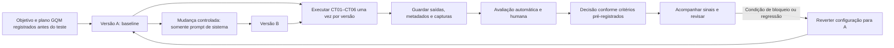

# Ciclo de vida e versionamento

Descrever a cadeia de mudança, execução, avaliação, decisão e acompanhamento do fluxo generativo, mantendo rastreabilidade entre casos, saídas e versões.

## Tarefa

Documentar o ciclo de vida experimental do objetivo à decisão e ao acompanhamento.

## Diagrama



## Cadeia de rastreabilidade

```text
caso (CT01–CT06) -> saída (versão-caso) -> nota (R1; R2 em CT01/CT05) -> decisão -> versão (A/B)
```

As versões experimentais A/B ainda dependem da definição e do registro dos prompts; as saídas, notas e decisões só podem ser vinculadas depois das respectivas etapas. Preservar os prompts, os manifestos e os resultados sem sobrescrever versões anteriores.

## Versionamento das configurações A e B

As respostas A e B já foram executadas em 11/11/2026. O estudante informou posteriormente o mesmo texto de prompt de sistema para ambas as condições; não há commits/tags A/B anteriores à execução. Não criar tags retroativas como se as configurações tivessem sido congeladas antes dos testes. O texto foi registrado nos arquivos de prompt, mas a configuração experimental completa não é reconstruível.

Para uma repetição futura autorizada, versionar cada configuração antes de executar qualquer caso:

1. Registrar o prompt A e o manifesto A, conferir os demais controles e criar um commit identificável para A.
2. Marcar esse commit com a tag `av3-a`.
3. Alterar somente o prompt de sistema para criar B; registrar o prompt e o manifesto B e criar outro commit.
4. Marcar o commit de B com a tag `av3-b`.
5. Conferir os alvos com `git show av3-a` e `git show av3-b`; registrar os hashes reais nos manifestos ou na evidência de execução.

Os nomes acima são sugestões para uma nova coleta, não tags já criadas nem identificadores das respostas existentes. Não mover ou reutilizar tags após as execuções. A escolha de `tau=0,5` ocorreu depois das respostas e é exploratória; não equivale a pré-registro.

| Caso | Saída A/B | Identificador anônimo | Nota(s) | Decisão | Versão/manifesto |
|---|---|---|---|---|---|
| [PREENCHER] | [PREENCHER] | [PREENCHER] | [PREENCHER] | [PREENCHER] | [PREENCHER] |

## Reprodução e reversão

### É possível reconstruir uma saída pelo manifesto?

Ainda não integralmente. O manifesto registra o commit do Cherry Studio, a versão do modelo e o prompt informado, mas parâmetros efetivos, arquivos/contexto recuperados e capturas não estão disponíveis. Mesmo com esses dados, o alias `latest` não congela a revisão do modelo e pode mudar; além disso, uma execução por caso/versão não mede a variabilidade entre execuções. A configuração pode ser descrita parcialmente, mas a reprodução exata da saída não é garantida.

### Que sinal acompanhar e como voltar a A?

Acompanhar, por versão, a aprovação humana R1 (aprovadas/6), a contagem de falhas críticas e a concordância entre sinal automático e R1 (concordantes/12 no conjunto). Usar os limites de avanço e bloqueio registrados previamente no plano GQM; eles ainda precisam ser preenchidos antes do teste. Uma falha crítica ou o não atendimento ao critério pré-registrado deve bloquear a adoção, não justificar ajuste retroativo do critério.

Para voltar à configuração A, interromper o uso de B, restaurar literalmente o prompt de sistema arquivado em `atividade3/versoes/A/prompt.md` e conferir o manifesto A, mantendo constante o commit do software, o modelo selecionado, os parâmetros, as fontes e o contexto sempre que operacionalmente possível. Registrar a reversão, sua data, o motivo e uma verificação com casos definidos pela equipe; não substituir os registros anteriores de B.

## Conteúdo do slide — Enzo

**Título:** Ciclo de vida e versionamento do fluxo generativo

- **A:** baseline com prompt simples.
- **B:** mudança controlada somente no prompt de sistema.
- **Execução:** seis casos por versão; preservar saídas, metadados e capturas.
- **Avaliação:** F1 automático e avaliações humanas R1/R2, com rastreabilidade até a decisão.
- **Reprodução:** o manifesto registra a configuração, mas `latest` pode mudar e uma execução por caso não mede variabilidade.
- **Reversão:** diante de bloqueio ou regressão segundo critérios pré-registrados, restaurar o prompt A e registrar a ação.

**Nota para apresentação:** não afirmar que as versões foram congeladas, executadas ou comparadas até haver commits, tags e evidências reais.

## Abertura do vídeo — Enzo

> Olá, somos a Equipe 04 da disciplina de Qualidade de Software da UFS. Nesta atividade, estudamos o fluxo de Base de Conhecimento do Cherry Studio e planejamos comparar duas configurações que diferem apenas no prompt de sistema. Vou apresentar o ciclo de vida e o versionamento previstos, as limitações de reprodução e os critérios para orientar a decisão. Se concluída, a comparação será apresentada com base nas execuções e avaliações registradas neste repositório.

> Se as execuções e avaliações ainda não estiverem concluídas, substituir a última frase por: “A comparação ainda não foi concluída; apresentaremos o plano e as limitações, sem alegar resultados experimentais.”

Não sugerir que os esqueletos ou o diagrama são evidência experimental.

## Análise do artefato

Com metadados e evidências completos, a cadeia caso -> saída -> nota -> decisão -> versão pode ser auditada. No estado atual, a rastreabilidade é parcial: o prompt foi relatado após as execuções, A e B usaram o mesmo texto, não há commits/tags de configuração anteriores, e faltam capturas/contextos e notas na rubrica oficial.

## Resultados

As 12 respostas textuais foram transcritas. Não há avaliações humanas independentes nem resultados F1 válidos; as referências atuais foram criadas com auxílio de IA e não satisfazem o requisito de referência escrita por pessoa. A decisão permanece inconclusiva.
