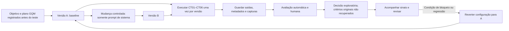

# Ciclo de vida e versionamento

Descrever a cadeia de mudança, execução, avaliação, decisão e acompanhamento do fluxo generativo, mantendo rastreabilidade entre casos, saídas e versões.

## Tarefa

Documentar o ciclo de vida experimental do objetivo à decisão e ao acompanhamento.

## Diagrama



## Cadeia de rastreabilidade

```text
caso (CT01–CT06) -> saída (versão-caso) -> nota (R1; subconjunto R2 transcrito) -> decisão -> versão (A/B)
```

As saídas e notas foram vinculadas a casos e versões nos registros atuais; contudo, os prompts foram informados após as execuções e não há capturas/contextos arquivados nem commits/tags experimentais anteriores. A rastreabilidade é parcial. Preservar os registros sem sobrescrever versões anteriores.

## Versionamento das configurações A e B

As respostas A e B já foram executadas em 11/11/2026. O estudante informou posteriormente prompts diferentes para as condições; os textos estão registrados, mas não há capturas/configurações arquivadas nem commits/tags A/B anteriores às execuções. Não criar tags retroativas como se as configurações tivessem sido congeladas antes dos testes. A configuração experimental completa não é reconstruível.

Para uma repetição futura autorizada, versionar cada configuração antes de executar qualquer caso:

1. Registrar o prompt A e o manifesto A, conferir os demais controles e criar um commit identificável para A.
2. Marcar esse commit com a tag `av3-a`.
3. Alterar somente o prompt de sistema para criar B; registrar o prompt e o manifesto B e criar outro commit.
4. Marcar o commit de B com a tag `av3-b`.
5. Conferir os alvos com `git show av3-a` e `git show av3-b`; registrar os hashes reais nos manifestos ou na evidência de execução.

Os nomes acima são sugestões para uma nova coleta, não tags já criadas nem identificadores das respostas existentes. Não mover ou reutilizar tags após as execuções. A escolha de `tau=0,5` ocorreu depois das respostas e é exploratória; não equivale a pré-registro.

| Caso | Saída A/B | Identificador anônimo | Nota(s) | Decisão | Versão/manifesto |
|---|---|---|---|---|---|
| CT01 | A e B | Q7M4P2 / M6A1Z4 | R1 e R2 reportados: 2,2,2,0 em ambas | Aprovada; concordância reportada | Manifestos A/B |
| CT05 | A e B | H4C9L7 / F3J6Q9 | R1 e R2 reportados: 2,2,2,0 em ambas | Aprovada; concordância reportada | Manifestos A/B |
| Demais CT | CT02–CT04, CT06 em A/B | Ver tabela consolidada | R1 reportado: 2,2,2,0 | Aprovada por R1 reportado; R2 (Douglas) também avaliou as 12 posteriormente, mas os escores dessas oito respostas não foram transcritos | Manifestos A/B |

## Reprodução e reversão

### É possível reconstruir uma saída pelo manifesto?

Ainda não integralmente. O manifesto registra o commit do Cherry Studio, a versão do modelo e o prompt informado, mas parâmetros efetivos, arquivos/contexto recuperados e capturas não estão disponíveis. Mesmo com esses dados, o alias `latest` não congela a revisão do modelo e pode mudar; além disso, uma execução por caso/versão não mede a variabilidade entre execuções. A configuração pode ser descrita parcialmente, mas a reprodução exata da saída não é garantida.

### Que sinal acompanhar e como voltar a A?

Acompanhar, por versão, a aprovação humana R1 (aprovadas/6), a contagem de falhas críticas e a concordância entre sinal automático e R1 (concordantes/12 no conjunto). O critério original não foi recuperado; o critério operacional atual foi definido após a coleta e serve somente para orientar nova avaliação confirmatória. Qualquer falha crítica deve bloquear a consideração de B até revisão, conforme regra operacional atual, sem alegar que essa regra foi pré-registrada.

Para voltar à configuração A, interromper o uso de B, restaurar literalmente o prompt de sistema arquivado em `atividade3/versoes/A/prompt.md` e conferir o manifesto A, mantendo constante o commit do software, o modelo selecionado, os parâmetros, as fontes e o contexto sempre que operacionalmente possível. Registrar a reversão, sua data, o motivo e uma verificação com casos definidos pela equipe; não substituir os registros anteriores de B.

## Conteúdo do slide — Enzo

**Título:** Ciclo de vida e versionamento do fluxo generativo

- **A:** baseline com prompt simples.
- **B:** mudança controlada somente no prompt de sistema.
- **Execução:** seis casos por versão; preservar saídas, metadados e capturas.
- **Avaliação:** F1 automático e avaliações humanas R1 (Thayla) e R2 (Douglas), com rastreabilidade até a decisão. Resultados transcritos: concordância R1–R2 4/4 no subconjunto inicialmente previsto; Douglas avaliou posteriormente as 12 saídas, mas os oito escores adicionais não estão transcritos.
- **Reprodução:** o manifesto registra a configuração, mas `latest` pode mudar e uma execução por caso não mede variabilidade.
- **Reversão:** diante de falha crítica, bloquear B conforme regra operacional atual, definida pós-coleta; restaurar A e registrar a ação.

**Nota para apresentação:** não afirmar que as versões foram congeladas, executadas ou comparadas até haver commits, tags e evidências reais.

## Abertura do vídeo — Enzo

> Olá, somos a Equipe 04 da disciplina de Qualidade de Software da UFS. Nesta atividade, estudamos o fluxo de Base de Conhecimento do Cherry Studio e planejamos comparar duas configurações que diferem apenas no prompt de sistema. Vou apresentar o ciclo de vida e o versionamento previstos, as limitações de reprodução e os critérios para orientar a decisão. Se concluída, a comparação será apresentada com base nas execuções e avaliações registradas neste repositório.

> Apresentar os resultados como exploratórios e reportados, distinguindo-os de evidência independente não anexada.

Não sugerir que os esqueletos ou o diagrama são evidência experimental.

## Análise do artefato

Com metadados e evidências completos, a cadeia caso -> saída -> nota -> decisão -> versão pode ser auditada. No estado atual, a rastreabilidade é parcial: os prompts foram relatados após as execuções, não há commits/tags de configuração anteriores, capturas/contextos e fichas originais não foram fornecidos; as justificativas são gerais e a rubrica/critério operacional foram formalizados após a coleta.

## Resultados

As 12 respostas e os resultados exploratórios de F1 foram registrados. R1 (Thayla) reportou 12 aprovações. R2 (Douglas) reportou concordância em 4/4 saídas do subconjunto inicialmente previsto e avaliou posteriormente todas as respostas; os oito escores adicionais não estão transcritos. A decisão permanece inconclusiva quanto à superioridade/adoção de B; confira as limitações de pré-registro, referências, configurações e evidências.
